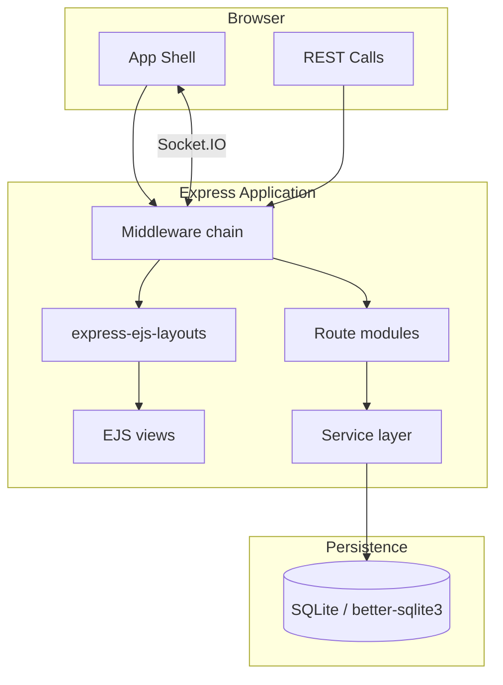

# Architecture

LeaxPanel(os) is a modular monolith. One Node.js process serves the UI, the REST API and the
Socket.IO channel. Everything persists in a single SQLite file.

---

## Layers



---

## Middleware chain

`server.js` registers the middleware in this exact order. The order matters.

| # | Middleware | Why here |
| --- | --- | --- |
| 1 | `helmet` | Security headers, CSP. |
| 2 | `compression` | Gzip responses. |
| 3 | `cors` | Origin policy from `config/security.js`. |
| 4 | `morgan` | Request log routed into winston. |
| 5 | `express.json` / `express.urlencoded` | Body parsing (50 MB limit for uploads). |
| 6 | `cookie-parser` | Needed by csurf. |
| 7 | `method-override` | `_method` support for HTML forms. |
| 8 | `express-session` | **SQLite store** — never the MemoryStore. |
| 9 | `connect-flash` | One-shot messages. |
| 10 | `csurf` | Must run **before** the locals middleware. Skipped for `/api/*`. |
| 11 | **Globals middleware** | Sets `res.locals.user`, flash messages, `csrfToken`, `currentPath`, panel settings, sidebar counters. |
| 12 | `express-layouts` | Wraps every view in `views/layout.ejs`. |
| 13 | `audit` | Records the request in `audit_logs` and mirrors to Discord. |
| 14 | `express.static` | `public/`. `maxAge` is 0 outside production. |
| 15 | **Routes** | Public routes first, then protected ones. |

> **Critical:** the CSRF middleware must be registered **before** the middleware that reads
> `req.csrfToken()`. If it is not, the hidden `_csrf` input renders empty and every POST fails
> with `EBADCSRFTOKEN`.

---

## Data layer — `config/db.js`

A thin, explicit wrapper around `better-sqlite3`. No `pg`-style emulation.

```js
const db = require('./config/db');

db.all(sql, params)   // -> array of rows
db.get(sql, params)   // -> first row or undefined
db.run(sql, params)   // -> { changes, lastInsertRowid }
db.exec(sql)          // -> multi-statement script (migrations, seeds)
db.tx(fn)             // -> transaction wrapper
db.prepare(sql)       // -> cached statement
```

A compatibility shim keeps the legacy `pool.query(sql, params)` call signature working and
returns `{ rows, rowCount }`.

**Pragmas enabled:** `journal_mode = WAL`, `foreign_keys = ON`, `busy_timeout = 5000`, `synchronous = NORMAL`.

> `stmt.all(params)` / `stmt.get(params)` / `stmt.run(params)` take an **array** of parameters.
> Multi-statement SQL strings must go through `db.exec()`, never `db.prepare()`.

`config/database.js` simply re-exports this module so legacy `require('../config/database')`
call sites keep working.

---

## Sessions

`config/sessionStore.js` implements the `express-session` `Store` interface on top of SQLite:

- Table `sessions (sid TEXT PRIMARY KEY, sess TEXT NOT NULL, expire INTEGER NOT NULL)`
- `get` / `set` / `destroy` / `touch` / `length` / `clear`
- `set` uses `ON CONFLICT(sid) DO UPDATE` so writes are idempotent
- A background timer (15 min, `unref`'d) deletes expired rows

This removes the `MemoryStore` production warning and makes sessions survive restarts without Redis.

---

## Declarative modules — `config/modules.js`

Every CRUD module is one object literal:

```js
defineModule({
  table: 'apps',
  module: 'apps',
  prefix: 'apps',
  perm: 'apps:view',
  title: 'Applications',
  subtitle: 'Deploy and manage NodeJS, PHP and WordPress applications',
  icon: 'box',
  orderBy: 'created_at DESC',
  fields: [
    { name: 'name', label: 'Application Name', required: true, maxLength: 120 },
    { name: 'type', label: 'Type', type: 'select', options: ['nodejs', 'php'] },
    { name: 'status', label: 'Status', type: 'select', options: ['running', 'stopped'] }
  ],
  columns: [
    { key: 'name', label: 'Application', primary: true },
    { key: 'type', label: 'Type', badge: true },
    { key: 'status', label: 'Status', status: true }
  ]
});
```

`routes/modules.js` mounts one `createResourceRouter()` per entry. The factory generates
list / create / edit / delete / detail routes, derives the validation chain from `fields`
and renders the shared partials.

Adding a module therefore means: create the table, add one object literal, run
`npm run generate:views`. No new route file, no new view file.

---

## View layer

`express-ejs-layouts` renders every view inside `views/layout.ejs`, which builds the app shell:

```
app-shell
├── sidebar.ejs      groups, icons, active state, pending-request pill
├── app-main
│   ├── topbar.ejs   breadcrumb, global search, quick create, theme, notifications, user menu
│   ├── app-content  flash messages + the view body
│   └── footer.ejs
└── sidebar-overlay
```

Shared partials keep the markup consistent:

| Partial | Purpose |
| --- | --- |
| `partials/head.ejs` | Meta, fonts, stylesheet (cache-busted by version) |
| `partials/sidebar.ejs` | Navigation |
| `partials/topbar.ejs` | Top navigation |
| `partials/footer.ejs` | Footer with links |
| `partials/flash.ejs` | Success / error / validation alerts |
| `partials/resourceTable.ejs` | Generic sortable table with badges and row actions |
| `partials/resourceForm.ejs` | Generic form grid driven by the module `fields` array |

> **Gotcha:** `include(path, locals)` injects locals through `with()`. A `const` in the partial
> that shadows a passed-in local name throws `Cannot access 'x' before initialization`.
> Use distinct local names (`btnLabel`, `cancelLink`, …).

---

## Authentication & authorisation

```
request ─► requireAuth ─► checkPermission('module:view') ─► handler
```

- `middleware/auth.js` — `requireAuth`, `requireGuest`, `optionalAuth`
- `middleware/rbac.js` — nine roles, 45 permissions, `checkPermission()`, `checkRole()`, `hasPermission()`
- `middleware/validation.js` — express-validator schemas and `handleValidationErrors`

The permission map in `middleware/rbac.js` is the single source of truth and is mirrored into the
`roles`, `permissions` and `role_permissions` tables by `initializeRoles()` so the UI can render
the matrix.

---

## Audit trail

`middleware/audit.js` wraps `res.send` and writes one row per authenticated request into
`audit_logs` (action, resource, method, path, status code, duration, IP, user agent).
Mutations and failures are additionally mirrored to the Discord webhook when
`DISCORD_WEBHOOK_URL` is configured.

---

## Background services

| Service | Responsibility |
| --- | --- |
| `monitoringService` | Samples CPU / memory / disk into `monitoring_metrics` |
| `autoHealingService` | Restarts unhealthy child services |
| `backupService` | Scheduled snapshots (`BACKUP_CRON`) writing manifests to `backups/` |

All three start with the server and stop cleanly on shutdown.

---

## Database schema

36 migrations, applied in numeric order and recorded in `schema_migrations`.

| Area | Tables |
| --- | --- |
| Identity | `users`, `roles`, `permissions`, `role_permissions`, `user_roles`, `sessions` |
| Hosting | `apps`, `app_env_vars`, `websites`, `services` |
| Infrastructure | `domains`, `dns_records`, `ssl_certificates`, `storage_buckets`, `cloudflare_zones` |
| Data | `databases`, `email_accounts`, `communication_channels`, `file_manager_files` |
| Automation | `bots`, `discord_bots`, `telegram_bots`, `whatsapp_instances`, `n8n_workflows` |
| AI | `ai_agents`, `ai_settings`, `ai_knowledge_bases`, `ai_knowledge_documents`, `ai_hosting_instances` |
| Business | `invoices`, `requests`, `request_messages`, `marketplace_items` |
| Platform | `audit_logs`, `security_events`, `notifications`, `api_keys`, `api_usage_log`, `webhooks`, `ip_lists`, `panel_settings`, `platform_settings`, `white_label_settings`, `backups`, `backup_snapshots` |

---

## Security model

| Concern | Implementation |
| --- | --- |
| Passwords | bcrypt, cost 12 |
| Sessions | SQLite store, `httpOnly`, `sameSite=lax`, `secure` in production, rolling expiry |
| CSRF | `csurf` with a cookie on every non-API form |
| Rate limiting | General (300 / 15 min), API (120 / min), auth (10 / 15 min, skips successes), write (60 / min) |
| Headers | `helmet` with a full CSP allowing Google Fonts, `ws:`/`wss:` and `'unsafe-inline'` for styles and scripts |
| Secrets at rest | AES-256-GCM via `utils/encryption.js` (key from `ENCRYPTION_KEY`) |
| API keys | SHA-256 hash, shown once, scoped, every call logged |
| 2FA | TOTP via `speakeasy`, QR code via `qr-image` |
| Input | express-validator schemas, length caps, path-traversal guards in the file manager |

---

## Testing & verification

| Tool | Purpose |
| --- | --- |
| `npm run verify` | Post-install checks (runtime, schema, seeds, views) |
| `npm run doctor` | 12 health checks, CLI output |
| `npm run crawl` | Logs in and requests every route, reporting 404s and 500s |
| `/doctor` | The same checks in the browser, with one-click fixes |
